<picture>
  <source media="(prefers-color-scheme: dark)" srcset="assets/banner-dark.svg">
  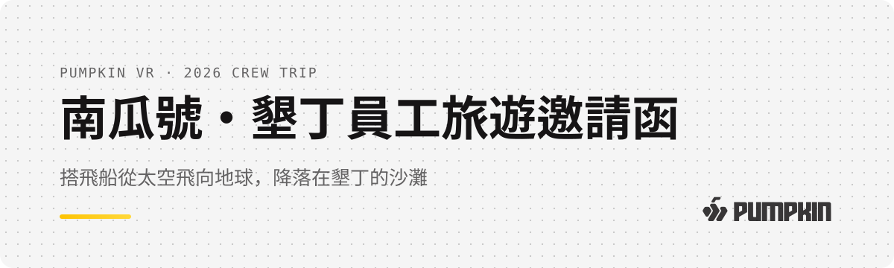
</picture>

<h1 align="center">🚀 南瓜號・墾丁員工旅遊邀請函</h1>

<p align="center"><b>一份要先「開飛船」才看得到內容的員工旅遊邀請函</b></p>

<p align="center">
  
  
  
  
</p>

<p align="center">
  <a href="#-這份邀請函有什麼">有什麼</a> •
  <a href="#-開場四幕">開場四幕</a> •
  <a href="#️-進到主頁之後">主頁</a> •
  <a href="#️-怎麼做出來的改了三次才對">製作過程</a> •
  <a href="#-拿去改成你的">拿去改</a> •
  <a href="#-常見問題">常見問題</a>
</p>

這是南瓜虛擬科技 2026 年員工旅遊的邀請函，做成一個網頁。同事打開連結，要先幫船長啟動引擎、設定航線、繫好安全帶，再按住按鈕飛向地球，降落在墾丁之後才看得到行程。

我們是做 VR 遊戲的公司，邀請函如果只是一張行程表，自己都覺得說不過去。看完這篇，你會知道它長什麼樣、怎麼做出來的，也可以把整包拿去改成你們公司的版本。

<p align="center">
  <a href="https://nanhong-byte.github.io/kenting-trip-invite/"><b>👉 直接玩一次（建議開聲音）</b></a>
</p>

<p align="center">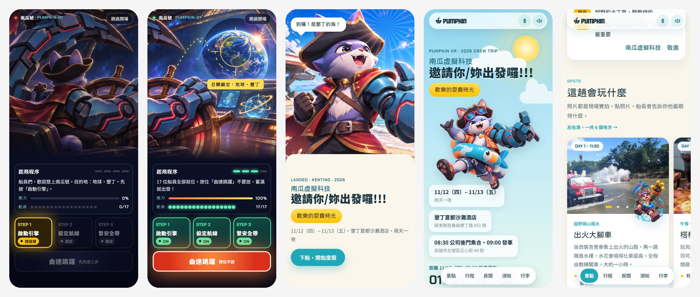</p>

## 📌 目錄

- [✨ 這份邀請函有什麼](#-這份邀請函有什麼)
- [🎬 開場四幕](#-開場四幕)
- [🏖️ 進到主頁之後](#️-進到主頁之後)
- [🤔 為什麼做這個](#-為什麼做這個)
- [🛠️ 怎麼做出來的：改了三次才對](#️-怎麼做出來的改了三次才對)
- [🧩 幾個做法細節](#-幾個做法細節)
- [🚀 拿去改成你的](#-拿去改成你的)
- [❓ 常見問題](#-常見問題)
- [📖 名詞對照表](#-名詞對照表)
- [🗺️ 接下來](#️-接下來)

## ✨ 這份邀請函有什麼

整份邀請函分成兩段：前面是一場約 30 秒的開場秀，後面是可以反覆回來查的旅遊資訊頁。

| | 內容 | 白話說 |
|---|---|---|
| 🚀 | 開場秀 | 駕駛艙三步起飛、長按曲速跳躍、穿越大氣層、降落海灘 |
| 💌 | 船長的話 | 公司想跟大家說的話，加三條規則：準時、安全、隨意 |
| 🏝️ | 這趟會玩什麼 | 六個地點的現場照片，手機上左右滑著看 |
| 🗓️ | 兩天行程 | 分 Day 1／Day 2，點任何一站展開地址、提醒和地圖 |
| 🛏️ | 房間分配 | 輸入名字，馬上標出你的房間和室友 |
| 🏨 | 飯店須知 | 進退房、用餐、泳池時間，還有一個「房號解碼器」 |
| 🎒 | 行李清單 | 一項一項勾，勾完會放彩帶 |

整個流程長這樣：

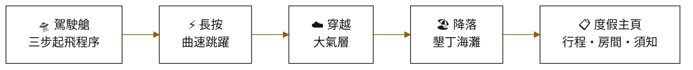

## 🎬 開場四幕

開場是整份邀請函的重點。每一步都要同事自己動手，畫面和聲音會立刻回應。

### 第一幕：駕駛艙

一打開就是怒錨船長握著舵輪，窗外是地球。下方有三顆按鈕，要照順序按。

<p align="center">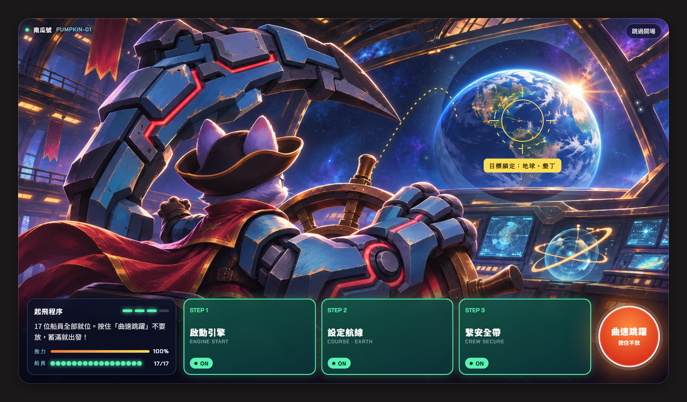</p>

每顆按鈕都有三種狀態，一眼就知道現在該按哪一顆：

| 狀態 | 長相 | 意思 |
|---|---|---|
| 鎖定 | 灰色、半透明 | 還不能按，前面的步驟沒做完 |
| 按這裡 | 金色外框、會發光 | 現在輪到這一顆 |
| ON | 綠色、掃過一道光 | 完成了 |

按下去之後，畫面會給回饋：

1. **啟動引擎**：畫面震動，底部亮起橘色推進光，推力條跑到 100%，引擎的低鳴聲會一直持續到起飛。
2. **設定航線**：準星滑到地球上，變成金色鎖定，從舵輪到地球畫出一條虛線。
3. **繫安全帶**：17 顆船員燈一顆一顆亮，每亮一顆都有一聲扣環聲。

> [!TIP]
> 按錯順序不會壞。按鈕會左右晃一下，船長日誌會告訴你現在該按哪一顆。

### 第二幕：曲速跳躍

三步都完成後，右下角的按鈕會變成橘紅色。這一顆要**按住不放**，蓄力條和音高會一起往上升，蓄滿就倒數 3、2、1、GO。

<p align="center">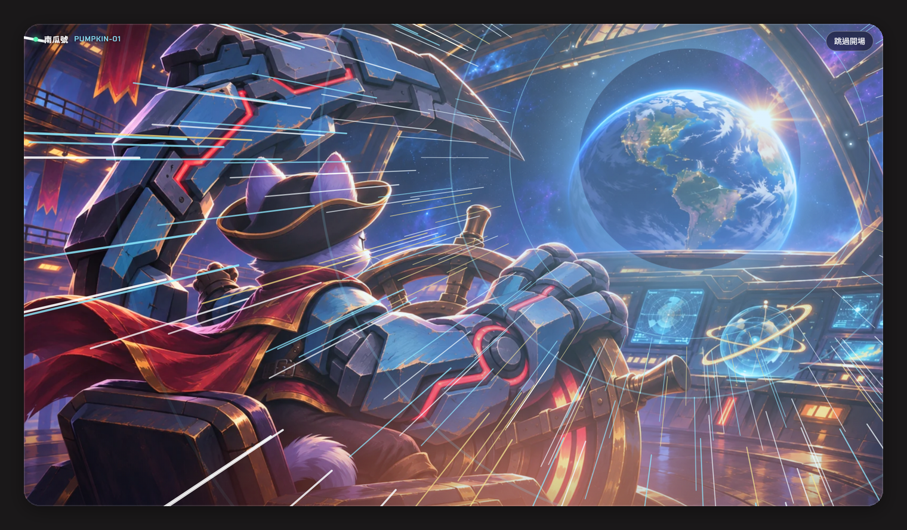</p>

這裡有一個我們很在意的細節：所有光束都從**地球那一點**往外射，鏡頭也朝地球放大。這樣看起來才像「正在朝地球衝過去」。如果光束從畫面正中央射出來，就只是一般的特效。

### 第三幕：穿越大氣層

畫面從太空的深藍轉成天空藍，雲從中間往外衝，高度從 400 公里倒數到 0。一開始畫面邊緣有一圈橘紅色，是進入大氣層的摩擦熱。

<p align="center">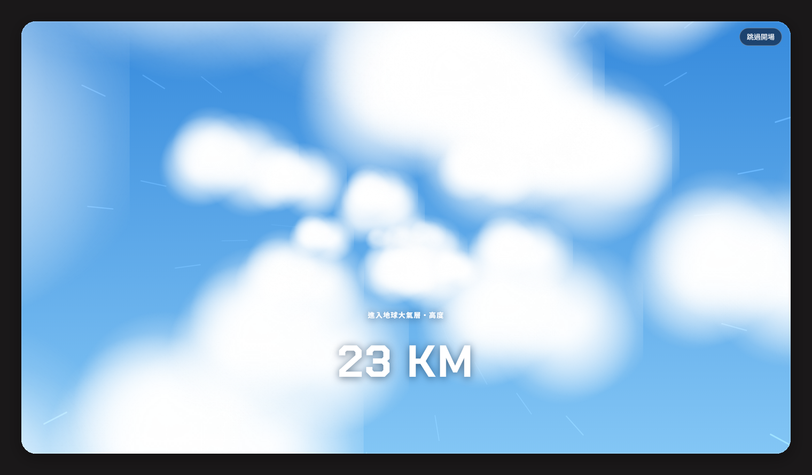</p>

### 第四幕：降落墾丁

閃光之後，船長已經站在沙灘上，南瓜號停在後面。這時候才出現主標題：「南瓜虛擬科技邀請你/妳出發囉!!!」

<p align="center">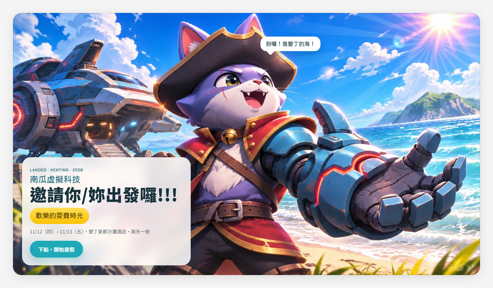</p>

按下「下船，開始度假」，一道浪花會把整個畫面捲走，進到主頁。

## 🏖️ 進到主頁之後

主頁的任務跟開場相反。開場要酷，主頁要讓人放鬆，而且資訊要好找，因為出發前和旅途中大家會一直回來查。

所以整頁換成淺色：天空藍、沙色底、三層慢慢流動的浪、圓圓的字。船長也換上夏威夷衫和泳圈。

<p align="center">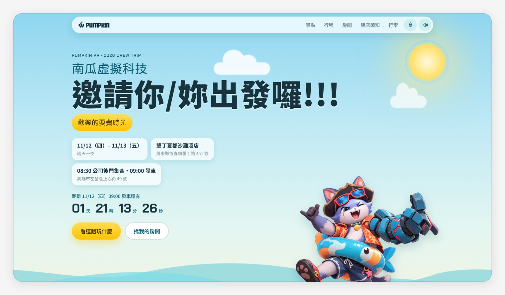</p>

### 先看好玩的，再看時間表

排版順序是故意的：先放「這趟會玩什麼」的照片，再放行程表。先讓人期待，再告訴他幾點集合。

<p align="center">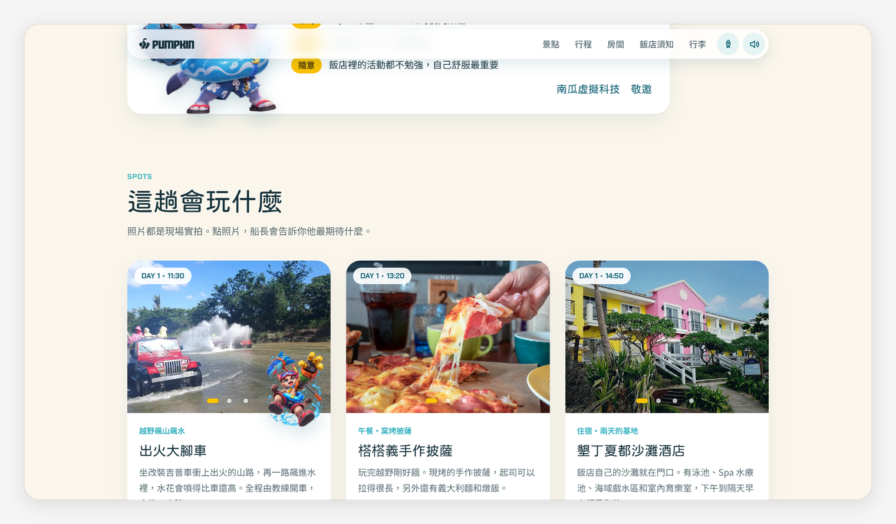</p>

照片都是各個地點的現場實拍。角色只出現在三個動態活動（越野、餵鹿、卡丁車）的卡片上，貼在照片下緣，不擋到照片。

### 輸入名字找房間

房間分配是大家最常問的問題。這裡做成輸入名字就標出房間和室友，不用在表格裡一格一格找。

<p align="center">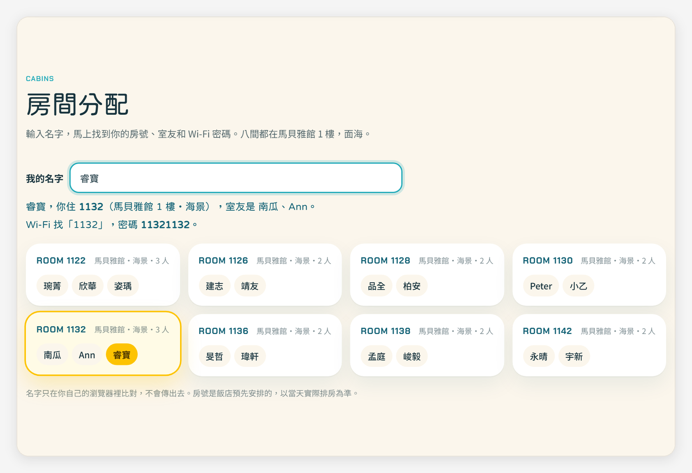</p>

### 房號解碼器

飯店的房號有規則：第一碼是樓層，第二碼是館別，後兩碼單數看山、雙數看海。Wi-Fi 密碼是房號打兩次。

與其叫大家背，不如做一個輸入框。拿到房卡後輸入四碼，馬上知道自己住哪一館、看山還是看海，密碼也算好了。

<p align="center">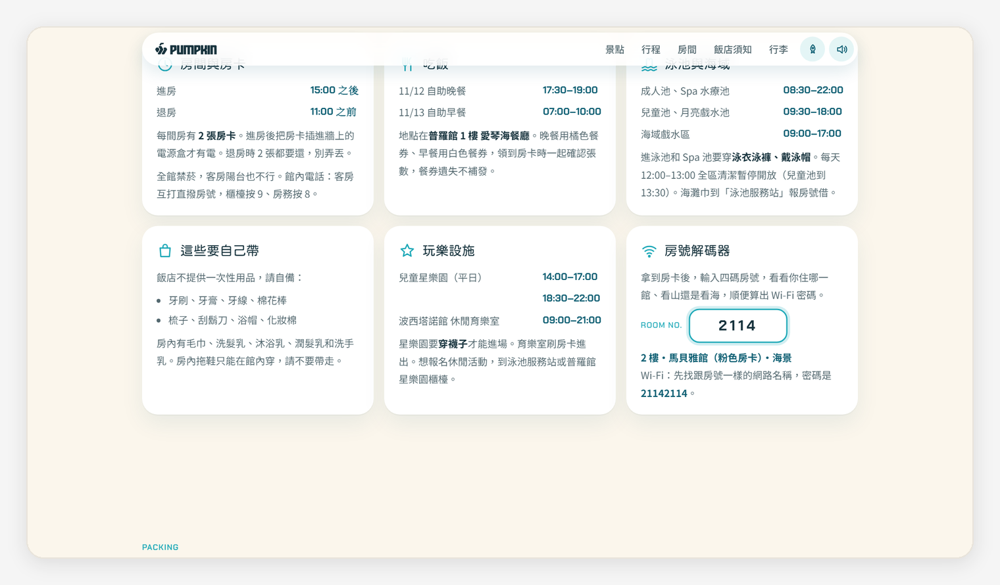</p>

<details>
<summary><b>主頁還有哪些小互動</b></summary>

- **戳船長**：點主視覺的船長，他會說話。一共五句，輪流出現。
- **點照片**：點景點照片，船長會說他對這個地方的期待。
- **倒數計時**：距離發車還有幾天幾時幾分幾秒。出發後會變成「大家正在墾丁耍費」。
- **行李清單**：每勾一項會響一個木琴音，音會一階一階往上。全部勾完放彩帶。
- **手機底部導覽**：景點、行程、房間、須知、行李，隨時跳轉，會標出目前在哪一區。
- **海浪聲**：進到主頁後有很輕的海浪背景音，右上角可以關。

</details>

## 🤔 為什麼做這個

以前公司辦活動，通知就是群組裡的一段文字加一張行程表截圖。資訊都在，但沒有人會因為那則訊息開始期待。

這次我們想試試看，邀請函本身能不能就是旅行的第一站。我們平常做遊戲，知道「自己動手按下去」和「看別人播給你看」的感受差很多。所以開場不做成影片，要同事自己把飛船開到墾丁。

另一個實際的原因是資訊太散。行程表、分房表、飯店須知是三份不同的文件。出發前有人問幾點集合，旅途中有人問晚餐在哪。全部放進一個網址，手機上隨時查得到。

## 🛠️ 怎麼做出來的：改了三次才對

這份邀請函是南瓜（美術總監）和 Claude Code 一起做的，前後做了三個版本。前兩版都被打槍，原因值得記下來。

| 版本 | 做法 | 結果 |
|---|---|---|
| 第一版 | 紅色布幕「拉開序幕」，連點拉繩開幕 | 互動可以，但美術沒有主題，像套版 |
| 第二版 | 請 AI 設計工具出一整套卡通手遊風場景和 UI | 被喊停：「很廉價的遊戲畫面」，角色和背景畫風對不上 |
| 第三版 | 美術總監自己畫駕駛艙、海灘和十幾個角色姿勢 | 過關。場景和角色出自同一隻手 |

第二版的教訓最大。我們的角色原本是 3D 渲染圖，AI 生成的背景是粗描邊的卡通插畫。兩種東西放在一起，角色看起來就是剪下來貼上去的。

後來的結論很簡單：**場景和角色要出自同一套美術**。只要這件事對了，其他都好談。

<details>
<summary><b>過程中還學到的幾件事</b></summary>

- **金色用太多會變廉價。** 第二版到處是亮面金按鈕、厚金邊、六角徽章，像抽卡手遊的商城。最後金色只留給「現在該按的那一顆」。
- **開場和內容頁要分開設計。** 開場可以華麗，但同一套華麗用在行程表上，讀起來很累。
- **角色不是越多越好。** 一度放了 9 個角色，三種毛色的貓同時出現，看起來像三個不同角色。最後減到 7 個，每個都有固定的位置和理由。
- **先放照片再放時間表。** 順序對調之後，整頁的感覺從「公告」變成「邀請」。
- **手機版要另外想。** 六張景點卡直排要滑很久，改成左右滑動後，整頁短了兩成。

</details>

## 🧩 幾個做法細節

這一段給想知道原理的人。不寫程式也看得懂大意，細節收在折疊裡。

### 光束怎麼對準地球

駕駛艙是一張圖，地球畫在右上角。圖片會依螢幕大小縮放裁切，所以地球在每支手機上的位置都不一樣。

做法是先記下地球在原圖上的比例位置（從左邊算 77.5%、從上面算 28%），再依照圖片實際被縮放裁切的方式，換算出地球在畫面上的座標。光束、準星、鏡頭放大的中心，全部用這個座標。

<details>
<summary><b>看換算的程式碼</b></summary>

```js
const NW = 1672, NH = 941;          // 原圖尺寸
const EX = .775, EY = .28;          // 地球在原圖上的比例位置

function earth() {
  const w = view.clientWidth, h = view.clientHeight;
  const s = Math.max(w / NW, h / NH);      // object-fit: cover 的縮放倍率
  const ox = (w - NW * s) * posX;          // 水平方向被裁掉多少
  const oy = (h - NH * s) * .5;            // 垂直方向被裁掉多少
  return { x: ox + EX * NW * s, y: oy + EY * NH * s };
}
```

`posX` 是圖片水平對齊的位置。手機上一開始對著船長（24%），按「設定航線」時平移到地球（86%），用的是同一張圖。

</details>

### 音效現場合成，背景音樂只有一首

除了一首背景音樂，整份邀請函沒有其他音效檔。引擎聲、鎖定聲、扣環聲、木琴、海浪，都是瀏覽器用 WebAudio 即時算出來的。

背景音樂（`img/bgm.mp4`，約 2 MB）只在**進入主頁之後**才開始，音量壓得很低，跟合成的海浪聲一起播。開場的駕駛艙和曲速階段不放音樂，讓引擎聲和特效音更清楚。

音效用合成的好處是不用找素材、不用擔心授權，檔案也小。更重要的是音效可以跟著互動變化：長按曲速時，音高會跟著蓄力條一起升；勾行李清單時，每一項的音都比上一項高一階。

<details>
<summary><b>每個聲音是怎麼做的</b></summary>

| 聲音 | 做法 |
|---|---|
| 引擎啟動 | 鋸齒波從 70Hz 滑到 420Hz（啟動馬達），0.8 秒後接一聲低頻衝擊（點火） |
| 引擎低鳴 | 四個振盪器疊在一起，經過低通濾波，持續到起飛 |
| 準星鎖定 | 三聲上行短音，接一個帶殘響的和音 |
| 安全帶 | 高頻雜訊短促爆一下，加一個方波短音，連續 17 次 |
| 曲速蓄力 | 一個持續的振盪器，頻率跟著蓄力進度走 |
| 木琴 | 正弦波加兩個泛音，衰減很快，送進殘響 |
| 海浪 | 白噪音過低通濾波，音量用 0.11Hz 的慢速波動控制 |

殘響也是算出來的：產生一段 2.4 秒、逐漸變小的雜訊當作空間的回音樣本。

</details>

### 一個檔案就是整個網站

整個網站是一個 `index.html`，沒有框架、沒有打包工具、沒有後端。圖片放在 `img/` 資料夾。

行程、景點、房間、行李清單都寫在檔案裡的幾個資料區塊。要改內容，改資料就好，不用碰畫面的程式。

## 🚀 拿去改成你的

想做你們公司的版本，三步就能跑起來。

```bash
git clone https://github.com/nanhong-byte/kenting-trip-invite.git
```

```bash
cd kenting-trip-invite
```

```bash
python -m http.server 8000
```

打開瀏覽器到 `http://localhost:8000`，看到駕駛艙就成功了。

> [!IMPORTANT]
> 要用上面的方式開一個本機伺服器，不要直接點兩下開 `index.html`。直接開的話，左上角的 Logo 會因為瀏覽器的安全限制顯示不出來。

接著打開 `index.html`，找到這幾個區塊改內容：

| 要改什麼 | 找這個 | 說明 |
|---|---|---|
| 景點 | `const SPOTS = {` | 名稱、說明、提醒、照片、地圖關鍵字 |
| 行程 | `const PLAN = {` | 每一站的時間、標題、對應哪個景點 |
| 房間 | `const ROOMS = [` | 每個中括號是一間房 |
| 行李清單 | `const BAG = [` | 項目和一句說明 |
| 船長的台詞 | `const TALK = [` | 戳船長時輪流出現的句子 |
| 發車時間 | `const T0 = Date.parse(` | 倒數計時的目標時間 |

<details>
<summary><b>想換掉駕駛艙和海灘的圖</b></summary>

1. 把你的圖存成 `img/v3-cockpit.webp` 和 `img/v3-beach.webp`，比例 16:9。
2. 駕駛艙的圖裡要有一個「目的地」（我們是地球）。量出它在圖上的位置比例，改掉 `EX`、`EY`、`ER` 三個數字（分別是水平位置、垂直位置、半徑佔圖寬的比例）。
3. 如果圖的尺寸不是 1672×941，把 `NW`、`NH` 也改掉。

角色圖是去背的 WebP，檔名 `c-` 開頭。換成你們自己的吉祥物就可以。

</details>

<details>
<summary><b>想放上網路給同事看</b></summary>

最簡單的做法是 GitHub Pages：

1. 把資料夾推上你自己的 GitHub repo。
2. 到 repo 的 Settings → Pages，Source 選 `main` 分支、根目錄。
3. 等一兩分鐘，網址會是 `https://你的帳號.github.io/repo名稱/`。

注意 GitHub Pages 的網址是公開的。房間分配這類資訊，請先想清楚要不要放真名。我們的做法是只放暱稱。

</details>

## ❓ 常見問題

<details>
<summary><b>開場可以跳過嗎？</b></summary>

可以，右上角有「跳過開場」。另外，如果連結帶著錨點（例如網址最後是 `#rooms`），會直接進到那一區，不播開場。適合在群組裡回答「房間在哪看」的時候貼。
</details>

<details>
<summary><b>手機上長按沒反應怎麼辦？</b></summary>

點兩下也可以，第二下之後會自動蓄滿發射。這是為了避免有些手機長按會跳出選單。
</details>

<details>
<summary><b>沒有聲音？</b></summary>

瀏覽器規定要使用者先點過畫面才能播聲音，所以按下第一顆按鈕之後才會有聲音。如果還是沒有，檢查手機是不是靜音模式，或右上角的喇叭有沒有被關掉。
</details>

<details>
<summary><b>勾過的行李清單會不見嗎？</b></summary>

不會。勾選狀態和輸入的名字存在你自己的瀏覽器裡，下次打開還在。這些資料不會傳到任何地方，所以換一支手機就要重勾。
</details>

<details>
<summary><b>為什麼不做成影片就好？</b></summary>

影片是看別人開飛船，這個是自己開。而且影片看完就結束了，網頁後半段的行程、房間、飯店須知，出發前和旅途中都還會回來查。
</details>

## 📖 名詞對照表

| 名詞 | 白話 | 在這裡的角色 |
|---|---|---|
| WebAudio | 瀏覽器內建的聲音合成器 | 所有音效都靠它現場算出來 |
| Canvas | 網頁上的一塊畫布，可以用程式一筆一筆畫 | 畫曲速光束、大氣層的雲、彩帶 |
| object-fit: cover | 圖片填滿容器，多的部分裁掉 | 讓同一張駕駛艙圖適應各種螢幕 |
| localStorage | 瀏覽器幫網站記東西的小抽屜 | 記住行李勾選狀態和名字 |
| GitHub Pages | GitHub 免費幫你把資料夾變成網站的服務 | 這份邀請函的對外網址 |
| 去背 | 把圖片背景變透明 | 角色才能疊在任何背景上 |

## 🗺️ 接下來

- [x] 駕駛艙開場、曲速、大氣層、降落
- [x] 行程、景點、房間、飯店須知、行李清單
- [x] 手機底部導覽、景點左右滑動
- [ ] 旅遊結束後，把景點照片換成同事自己拍的
- [ ] 加一個「旅遊回顧」模式：倒數結束後自動變成相簿
- [ ] 把駕駛艙開場抽出來，做成可以重複使用的活動邀請函樣板

## 素材與授權

- **角色與場景插圖**：南瓜虛擬科技自製，角色「怒錨船長」出自公司的 VR 遊戲《Quantaar》。請不要拿去另作他用。
- **背景音樂**：〈Happy Background Music 012〉，從南瓜提供的影片中取出音軌。
- **景點照片**：版權屬於各原作者，僅用於介紹該地點。來源：
  [悠遊墾丁](https://uukt.com.tw/kenting/5447)、
  [出火大腳旅遊車隊](https://ouokt.com/product.php?PCode=10196)、
  [阿信 shin.tw](https://shin.tw/pingtung-tatayi/)、
  [蕃薯藤旅遊](https://travel.yam.com/article/129681)、
  [痞客邦 仙蹤](https://simpleball.pixnet.net/blog/posts/14222352210)、
  [carlming.net](https://carlming.net/60764)、
  [ETtoday 旅遊雲](https://travel.ettoday.net/article/2651124.htm)、
  [夏都沙灘酒店](https://www.ktchateau.com.tw/)、
  Wikimedia Commons（S099001，公有領域；caich，CC BY 3.0；Jerry Lai，CC BY-SA 2.0；AdriCWP，CC BY-SA 2.0）。
- **程式碼**：歡迎參考、修改，做成你們自己的邀請函。

如果你是照片的原作者，希望我們換掉照片，請開 Issue 告訴我們。

— 南瓜｜南瓜虛擬科技 · XR／3D／AI 工作流

<sub>由 南瓜虛擬科技 製作 · 最後更新 2026-11-10</sub>
